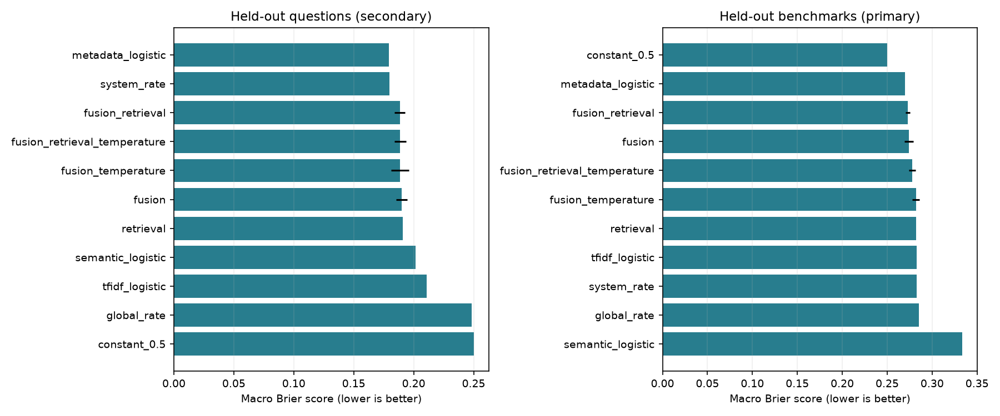
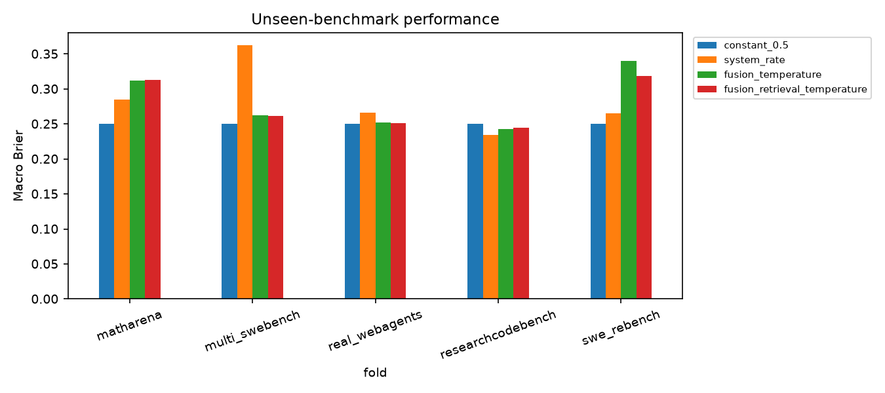
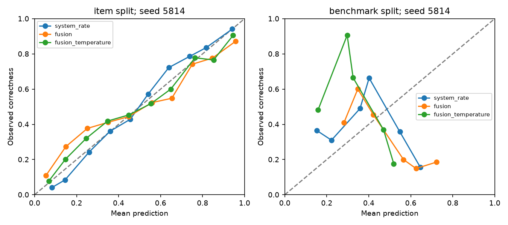
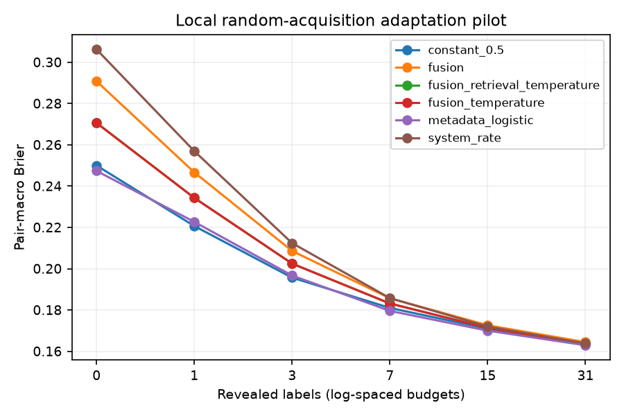

# ColdCast: executed real-data checkpoint results

**Status:** real-data pilot completed. The five-page IEEE report now incorporates these findings; live publication remains pending verification.

## Main findings

- Within known benchmarks, metadata-only logistic regression outperformed the tested neural fusion variants. The original claim that fusion improves over all baselines is not supported by this pilot.
- On entirely unseen benchmarks, constant 0.5 was the best overall predictor among the evaluated methods. Benchmark shift and unseen system configurations remain the main failure modes.
- Limited-label adaptation reduced error on a fixed evaluation pool. A simple adapted metadata baseline performed about as well as an adapted constant prior and better than the tested fusion alternatives by Brier ALC. Do not attribute the benefit solely to deep learning.
- These are local offline measurements, not official competition scores. Models and settings were fixed before inspecting test results.

## Data and scope

Pinned measurement-db revision: `54074453da7b9911be0f48e4c560be547bc84d21`. Download: 37 files, approximately 122 MB; no raw archives, traces or image assets.
Pilot: **51,751 recorded responses**, **1,345 exact-normalized-text groups**, five source benchmark collections. Sample at most 300 text groups per source with seed 5814, retain every response to selected groups. Item IDs can outnumber text groups because duplicate text may have multiple IDs.

| Collection | Selected responses | Item IDs | Text groups | System configurations | Correctness rate |
| --- | ---: | ---: | ---: | ---: | ---: |
| matharena | 29,007 | 356 | 300 | 92 | 0.665 |
| multi_swebench | 8,327 | 308 | 300 | 82 | 0.141 |
| real_webagents | 4,449 | 233 | 233 | 33 | 0.358 |
| researchcodebench | 6,784 | 212 | 212 | 31 | 0.361 |
| swe_rebench | 3,184 | 303 | 300 | 1 | 0.483 |

MMDocRAG was excluded because its scores measure graded answer quality. MathArena selection required an explicitly binary grading scale; partial-credit rubric items were excluded even when particular outcomes happened to equal 0 or 1. Tasks with declared image assets were excluded. Reference answers, graders, and traces were not used as model features.

Exact duplicate text cannot cross source folds; zero such cross-source groups were found. A semantic screen found no cross-source pair with cosine similarity >= 0.98, but this is not proof that all source overlap or paraphrases are absent. Within-source splits can still share paper families or templates.

The data remain local and excluded from Git. REAL and ResearchCodeBench metadata list unknown upstream licenses; this run does not establish redistribution rights. Preserve their source metadata and do not publish their raw tables.

## Zero-label results

Brier scores are squared probability errors; lower is better, and a constant 0.5 has score 0.25. Neural numbers below average three fixed training seeds. Standard deviations describe seed variability, not confidence about all future benchmarks.

| Model | Held-out questions: macro Brier | Held-out benchmarks: macro Brier |
| --- | ---: | ---: |
| constant_0.5 | 0.2500 | 0.2500 |
| global_rate | 0.2486 | 0.2850 |
| system_rate | 0.1799 | 0.2825 |
| metadata_logistic | 0.1794 | 0.2699 |
| tfidf_logistic | 0.2110 | 0.2825 |
| semantic_logistic | 0.2018 | 0.3335 |
| retrieval | 0.1910 | 0.2822 |
| fusion | 0.1900 +/- 0.0048 | 0.2738 +/- 0.0049 |
| fusion_temperature | 0.1887 +/- 0.0074 | 0.2819 +/- 0.0041 |
| fusion_retrieval | 0.1884 +/- 0.0042 | 0.2730 +/- 0.0023 |
| fusion_retrieval_temperature | 0.1886 +/- 0.0048 | 0.2778 +/- 0.0035 |

**Primary protocol:** five leave-one-source-benchmark-out folds. For each fold, one other source is development, another is calibration, and the remaining two are training. Within each held-out source, average equally over system configurations; then average the five source scores equally. All partitions are disjoint at source and exact-text level. This deliberately strict pilot uses only two training sources per fold.

**Secondary protocol:** within each source, split normalized-text groups approximately 60/15/10/15 percent into training/development/calibration/test. Actual counts: 31,703 / 7,796 / 5,009 / 7,243 responses. Report the equally weighted subject-source score across this test set. This answers a weaker question than unseen-source transfer; the two columns use different test composition and should not be treated as a controlled estimate of the size of distribution shift.

| Held-out source | Test response fraction with unseen system configuration | Unseen canonical model |
| --- | ---: | ---: |
| matharena | 100.0% | 93.1% |
| multi_swebench | 100.0% | 48.5% |
| real_webagents | 100.0% | 46.2% |
| researchcodebench | 56.2% | 53.1% |
| swe_rebench | 100.0% | 100.0% |

The five-fold paired bootstrap intervals are saved in `results/real/paired_benchmark_intervals.json`. Only five benchmark clusters support them, so the intervals are descriptive and unstable. They do not establish a general neural advantage.

## Limited-label adaptation

Evaluated **122 eligible system-source pairs** with at least 80 distinct text groups. Each pair uses a deterministic random 50/50 acquisition/evaluation split. Reveal one recorded outcome per acquired group along a nested random trajectory. Evaluation labels never enter the adaptation fit.

A scalar logit correction is fitted from acquired labels with a fixed unit Gaussian prior. Budgets are 0, 1, 3, 7, 15 and 31. ALC uses weights 0.1, 0.2, 0.2, 0.2, 0.2 and 0.1. This experiment averages eligible pairs equally and uses only their evaluation pools, so its zero-label numbers differ from the table above.

| Starting predictor + adaptation | Zero-label Brier | 31-label Brier | Brier ALC |
| --- | ---: | ---: | ---: |
| metadata_logistic | 0.2474 | 0.1629 | 0.1948 |
| constant_0.5 | 0.2500 | 0.1634 | 0.1950 |
| fusion_temperature | 0.2706 | 0.1635 | 0.2017 |
| fusion_retrieval_temperature | 0.2707 | 0.1634 | 0.2017 |
| fusion | 0.2908 | 0.1644 | 0.2082 |
| system_rate | 0.3062 | 0.1638 | 0.2124 |

The difference between adapted metadata and adapted constant probability is small; do not claim statistical superiority. One acquisition trajectory per pair was used, so acquisition-order uncertainty is not measured. Uncertainty/diversity acquisition policies and official-container compatibility are not evaluated.

## Implementation and verification

Frozen encoder: `sentence-transformers/all-MiniLM-L6-v2` at revision `1110a243fdf4706b3f48f1d95db1a4f5529b4d41`. Output dimension 384. For prompts exceeding 254 tokens, retain the first 127 and last 127 plus special tokens; masked mean pooling and normalization. **602 of 1345 text groups required truncation**, including long research-paper prompts. No fine-tuning or paid model API was used.

Fusion: six categorical fields with 8-dimensional embeddings, hidden widths 64/32, ReLU, dropout 0.15, category masking 0.10, AdamW learning rate 0.001 and weight decay 0.0001. Batch size 1,024, at most 40 epochs, development macro-Brier early stopping with patience 7. Temperature grid 0.2 to 5, selected using calibration log loss. Retrieval uses 10 training-item neighbors and excludes the same text group from training queries; its global smoothing prior is fitted on training data.

Training seeds: [5814, 5815, 5816]. The full training/comparison run took 147.3 seconds on this machine, excluding downloads, setup, encoding and analysis. Encoder execution took 15.4 seconds. Timings are single-run observations, not benchmarked speed claims.

- Seven original prototype tests, seven real-data tests, and three adaptation tests passed (17 total).
- An independently reloaded offline predictor reproduced a saved test probability within 1e-5.
- Saved artifacts include all model configurations, checkpoints, splits, data and model revisions, environment versions, metrics and predictions.
- No test-score-driven hyperparameter search was performed after inspecting the reported results.

## Figures









Reliability curves pool responses and show one fixed seed; they are diagnostics, not the benchmark-macro scoring rule.

## Report revision checklist (incorporated in the IEEE source)

1. Replace synthetic-only dataset/results descriptions with the audited pilot and tables above; retain the synthetic fixture only as a software test.
2. Describe MiniLM, learned categorical embeddings, PyTorch training, retrieval, and scalar limited-label adaptation as implemented, with their actual constraints.
3. State that the main fusion-superiority hypothesis is not supported. Simple metadata/history is competitive within known sources, while cold-source performance remains poor.
4. Add a compact comparison table and adaptation result; explain different pools/weighting and avoid comparing their scores as though they were identical tests.
5. Record the user securing access and directing the work separately from assistant-generated code and experiments; do not assign these executions to absent teammates.
6. Keep remaining work specific: broader source coverage, better system transfer, less aggressive text truncation, repeated acquisition trajectories, active acquisition policies, and official packaging.
7. The report compiles to five IEEE pages; public posting still requires verification.

## Reproduce

From the repository root, with the existing environment activated:

```sh
source checkpoint1/.venv/bin/activate
python checkpoint1/src/fetch_real_data.py --revision 54074453da7b9911be0f48e4c560be547bc84d21
python checkpoint1/src/prepare_real_data.py
python checkpoint1/src/encode_real_items.py
python checkpoint1/src/test_pipeline.py
python checkpoint1/src/test_real_pipeline.py
python checkpoint1/src/test_adaptation.py
python checkpoint1/src/train_real_models.py
MPLCONFIGDIR=checkpoint1/tmp/matplotlib python checkpoint1/src/analyze_real_results.py
python checkpoint1/src/summarize_real_run.py
```

Use `results/real/environment-lock.txt` to recreate the recorded environment. Raw data, pretrained weights and row-level predictions are local artifacts, excluded from Git. The local `predict_real.py` entry point supports the saved non-retrieval fusion model; it is not a competition deployment package.
