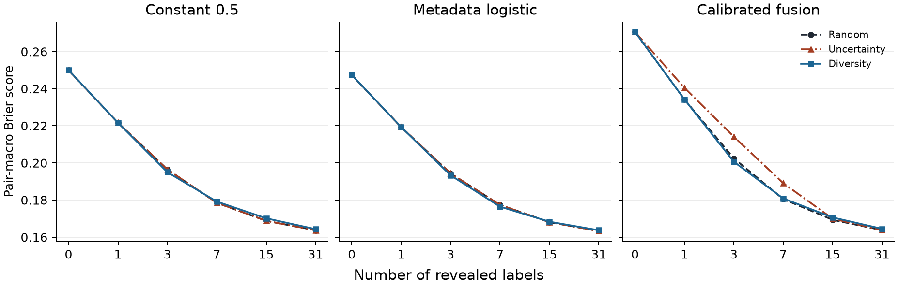
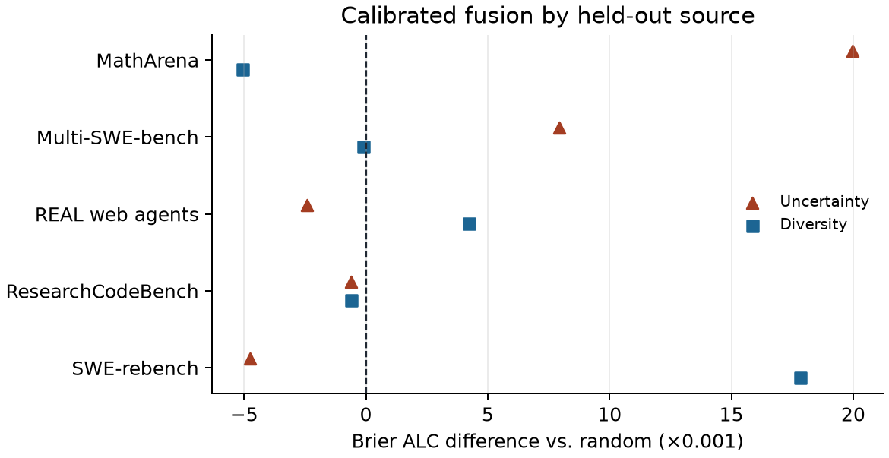

# ColdCast real-data results

The study compares label selection policies on fixed, source-held-out predictions. The input predictor study used **51,751 responses** across five sources from pinned measurement-db revision `54074453da7b9911be0f48e4c560be547bc84d21`. The acquisition comparison evaluates **122 eligible system–source pairs** with at least 80 distinct normalized-text groups each. It reuses the original embeddings, predictions, acquisition/evaluation split, and one recorded acquisition outcome per group. No predictor was retrained for this comparison.

| Source | Eligible pairs |
| --- | ---: |
| matharena | 20 |
| multi_swebench | 44 |
| real_webagents | 26 |
| researchcodebench | 31 |
| swe_rebench | 1 |

## Protocol and run

- **Starting predictors:** constant 0.5, metadata logistic regression, and temperature-scaled neural fusion.
- **Policies:** seeded random selection, adaptive selection closest to probability 0.5, and farthest-first selection in normalized embedding space.
- **Budgets:** 0, 1, 3, 7, 15, and 31 labels. ALC is the weighted sum of budget-specific Brier scores, using 0.1, 0.2, 0.2, 0.2, 0.2, and 0.1.
- **Trials:** 12 acquisition seeds (6200–6211) crossed with three original training seeds. Constant and metadata predictions repeat across training seeds. The same random ordering determines tie breaks and the first diversity selection.
- **Scoring:** mean squared probability error within each pair, followed by an equal average over eligible pairs. The analysis also compares policies under equal source weights. Lower is better.
- **Label separation:** acquisition only receives already revealed outcomes. Evaluation uses a fixed disjoint set. All policies update the same scalar logit offset with a unit-Gaussian penalty.
- **Output:** 237,168 pair-budget scores before aggregation. The aggregate CSVs are published here.

## Results by budget

Trial SD is the standard deviation of the aggregate ALC across acquisition seeds.

| Starting predictor | Policy | 0 | 1 | 3 | 7 | 15 | 31 | Brier ALC | Trial SD |
| --- | --- | ---: | ---: | ---: | ---: | ---: | ---: | ---: | ---: |
| Constant 0.5 | Random | 0.2500 | 0.2217 | 0.1965 | 0.1785 | 0.1688 | 0.1637 | 0.19446 | 0.00195 |
| Constant 0.5 | Uncertainty | 0.2500 | 0.2217 | 0.1965 | 0.1785 | 0.1688 | 0.1637 | 0.19446 | 0.00195 |
| Constant 0.5 | Diversity | 0.2500 | 0.2217 | 0.1950 | 0.1792 | 0.1701 | 0.1643 | 0.19463 | 0.00166 |
| Metadata logistic | Random | 0.2474 | 0.2193 | 0.1943 | 0.1774 | 0.1681 | 0.1633 | 0.19288 | 0.00152 |
| Metadata logistic | Uncertainty | 0.2474 | 0.2193 | 0.1943 | 0.1774 | 0.1681 | 0.1633 | 0.19288 | 0.00152 |
| Metadata logistic | Diversity | 0.2474 | 0.2193 | 0.1933 | 0.1764 | 0.1683 | 0.1637 | 0.19259 | 0.00128 |
| Calibrated fusion | Random | 0.2706 | 0.2342 | 0.2024 | 0.1805 | 0.1693 | 0.1638 | 0.20074 | 0.00217 |
| Calibrated fusion | Uncertainty | 0.2706 | 0.2405 | 0.2142 | 0.1891 | 0.1699 | 0.1638 | 0.20617 | 0.00030 |
| Calibrated fusion | Diversity | 0.2706 | 0.2342 | 0.2006 | 0.1808 | 0.1706 | 0.1645 | 0.20077 | 0.00169 |



Random selection with metadata reduced Brier from 0.2474 at zero labels to 0.1943 at three labels and 0.1633 at 31. For calibrated fusion, uncertainty selection had higher Brier than random at three labels (0.2142 versus 0.2024) and higher ALC (0.20617 versus 0.20074). For constant and metadata predictors, flat logits made uncertainty selection identical to paired random selection.

## Source sensitivity

The table shows calibrated fusion ALC differences relative to random, multiplied by 1,000. A positive value means higher error.

| Source | Eligible pairs | Uncertainty | Diversity |
| --- | ---: | ---: | ---: |
| matharena | 20 | +19.98 | -5.05 |
| multi_swebench | 44 | +7.94 | -0.10 |
| real_webagents | 26 | -2.41 | +4.23 |
| researchcodebench | 31 | -0.62 | -0.61 |
| swe_rebench | 1 | -4.76 | +17.81 |



For metadata, diversity reduced pair-weighted ALC by 0.00030 and increased equal-source ALC by 0.00249. The sign change and the single eligible SWE-rebench pair limit any claim of a general diversity benefit. These experiments use the same five retrospective sources and fixed outcomes. Trial variability measures acquisition order sensitivity within these pools. Broader transfer needs independent data.

## Verification and reproduction

The runner verified that the original pools were reproduced, orders used distinct groups, zero-label results agreed across policies, and all Brier scores were valid. Replaying the earlier experiment matched its saved scores within 1e-15. The maximum replay difference from switching to the double-precision offset solver was 0.000053. Repeated runs regenerated byte-identical result CSVs and figures.

From the repository root, with the original local data artifacts and environment:

```bash
checkpoint1/.venv/bin/python checkpoint2/src/run_acquisition.py
MPLCONFIGDIR="$PWD/checkpoint2/tmp/matplotlib" checkpoint1/.venv/bin/python checkpoint2/src/plot_results.py
```

See the [run record](results/run.json) for input hashes and acquisition seeds, the [README](README.md#reproduce-or-demo) for dependencies, and the [original experiment](../checkpoint1/REAL_RESULTS.md) for data provenance. Saved response-level inputs remain local. This study reports offline research results.
