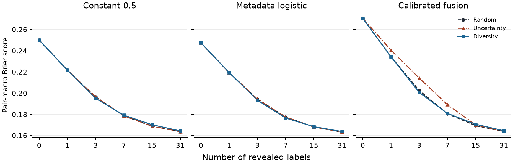

# ColdCast: Calibrated Cold-Start Prediction of AI System Performance

Yi Chen Kuo, Sudip Manchare, Jaideep Manupati, and Akshada Shailesh Rane  
Department of Computer Science, Virginia Tech

This Markdown companion summarizes the [editable IEEE source](ColdCast_Checkpoint_II_IEEE.tex). The [seven-page PDF](output/pdf/ColdCast_Checkpoint_II_IEEE.pdf) is the formatted report. Detailed tables and reproduction commands are in [REAL_RESULTS.md](REAL_RESULTS.md).

## Abstract

ColdCast predicts whether an AI system will answer an unseen task correctly. A study of eleven predictors used 51,751 recorded responses across five benchmark sources. Constant 0.5 achieved the lowest Brier score (0.2500) when whole sources were held out. A subsequent experiment on fixed pools for 122 system–source pairs tested random, uncertainty, and diversity label selection. With random selection, metadata logistic regression improved from 0.2474 to 0.1633 Brier after 31 labels. Uncertainty selection increased weighted learning-curve error for calibrated fusion. Diversity's small gain for metadata reversed when benchmarks received equal weight.

## Motivation and approach

The aim is to predict correctness probabilities for new tasks without running the target system on every item. Prior work on amortized evaluation and adaptive testing motivates using historical outcomes and limited new labels. ColdCast compares global and system rates, text and metadata logistic regressions, a retrieval baseline, and neural fusion variants. Fusion combines a frozen MiniLM item embedding with learned system metadata embeddings. Retrieval uses only training outcomes. Temperature scaling uses a separate calibration split.

## Data and evaluation

The pinned measurement-db sample contains 51,751 recorded responses and 1,345 normalized text groups from MathArena, Multi-SWE-bench, REAL web agents, ResearchCodeBench, and SWE-rebench. The primary experiment holds out whole sources. A secondary item holdout within known sources measures performance in a different setting. In both cases, the training, development, calibration, and test groups have separate functions.

Brier score is the mean squared error between predicted probabilities and observed binary outcomes. Lower is better. The zero-label source-holdout analysis averages systems within sources, then weights sources equally. The acquisition analysis averages eligible system–source pairs equally and reports an additional equal-source sensitivity check.

## Zero-label prediction and initial adaptation

Metadata logistic regression led on held-out items within known sources (Brier 0.1794). Across held-out sources, the constant 0.5 baseline achieved 0.2500, compared with 0.2699 for metadata and 0.2738 for uncalibrated fusion. Temperature scaling helped fusion on the item split but worsened Brier on unseen sources.

In the initial adaptation experiment, each eligible pair was split into disjoint pools for acquiring labels and scoring predictions. Revealed labels were used to fit a regularized scalar shift to the starting predictor's logits. The single-order run demonstrated an improvement with labels and motivated measuring the effect of selecting them.

## Label selection on unseen sources

The comparison reuses the same 122 pairs, fixed pools, frozen predictions, and recorded outcomes. Random selection uses a seeded permutation. Uncertainty selects the current probability closest to 0.5 and updates the offset after each label. Diversity starts from the same seed item as random and then selects the item farthest from its closest previously selected embedding. All three policies use the same offset update and evaluation groups.

The study used 12 acquisition trials, three original training seeds, three starting predictors, and budgets of 0, 1, 3, 7, 15, and 31 labels. Weighted Brier ALC summarizes the six budget scores with weights of 0.1, 0.2, 0.2, 0.2, 0.2, and 0.1.

| Comparison | Result |
| --- | --- |
| Metadata with random selection | 0.2474 at zero labels, 0.1943 at three labels, and 0.1633 at 31 labels |
| Calibrated fusion at three labels | 0.2024 with random and 0.2142 with uncertainty selection |
| Calibrated fusion weighted Brier ALC | 0.20074 with random and 0.20617 with uncertainty selection |
| Metadata diversity versus random | ALC difference of −0.00030 with pair weighting and +0.00249 with equal source weights |

## Individual progress

The team confirmed the data validation, modeling, adaptation, and integration work documented in the [contribution record](CONTRIBUTIONS.md).

## Limitations and conclusion

This retrospective comparison reuses five benchmark sources and a fixed recorded outcome per acquired text group. Repeated acquisition trials measure order sensitivity. They do not measure how a new source or another realization of an outcome would change the result. The scalar update changes the overall correctness level for a pair while leaving item rankings unchanged. Limited-label adaptation improved the evaluated predictions, and random selection provides a reference for future experiments on independent sources. The bibliography is in the [IEEE report](output/pdf/ColdCast_Checkpoint_II_IEEE.pdf).
